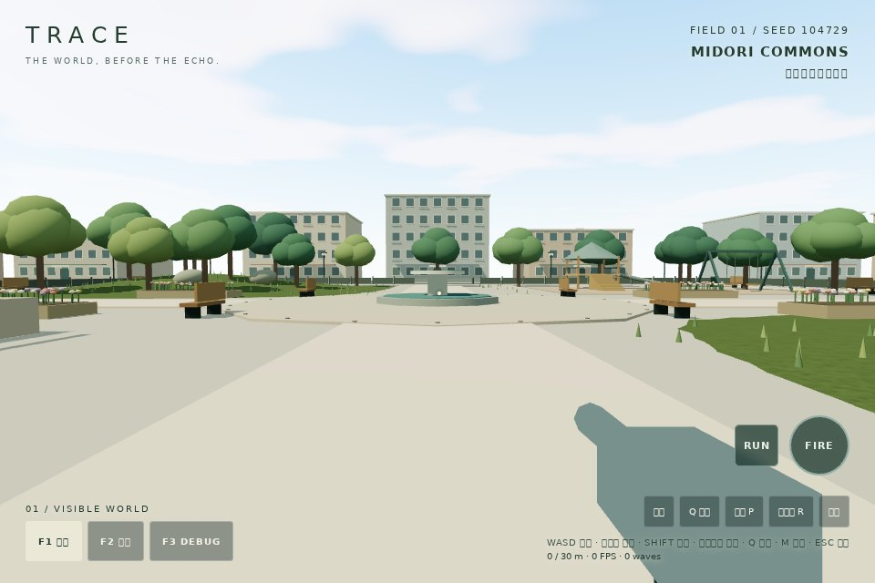
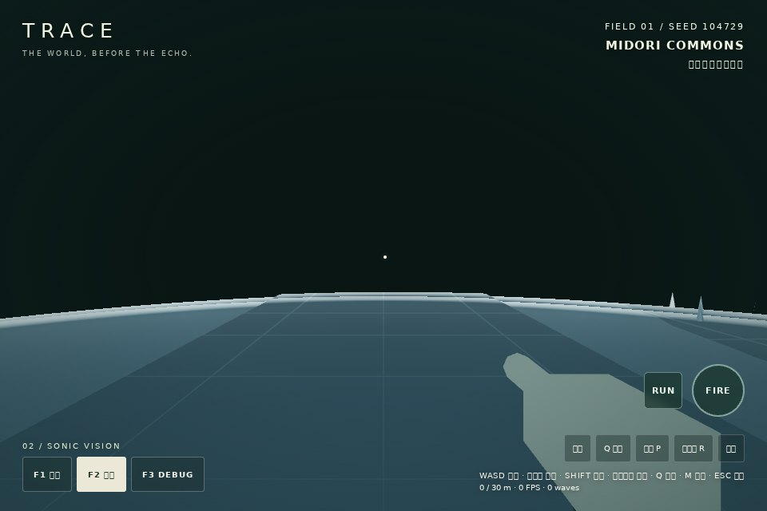

# GitHub Pages公開

テストプレイURL: https://yuji5124.github.io/TRACE/

## 原因と修正

2026-10-21、基準main `0de6db5` の公開URLはHTTP 404。
既存 `ci.yml` はテスト・ビルド・ブラウザ検証のみで、Pagesへdistを転送する処理がなかった。
`.github/workflows/deploy-pages.yml` を追加し、mainへのpush / workflow_dispatchで
Node.js 22・npm ci・npm run build後にdistをGitHub Pagesへ公開する。
PagesのSourceはユーザーがGitHub Actionsへ設定済み。

公開ワークフローは検証ワークフローを待たない。既存CIの検査は変更・無効化していない。
公開ジョブは同じワークフロー内のビルド成功を必須とする。
`github-pages` environmentとdeploy-pagesのpage_urlを使用。
手動実行もmainのみ。concurrencyで同時デプロイを直列化する。

## Actionsの確認

2026-10-21、各公式リポジトリのlatest releaseとaction.ymlを確認。

| Action | 採用major | 確認した安定版 |
|---|---|---|
| [checkout](https://github.com/actions/checkout/releases/tag/v7.0.1) | v7 | v7.0.1 |
| [setup-node](https://github.com/actions/setup-node/releases/tag/v7.1.0) | v7 | v7.1.0 |
| [configure-pages](https://github.com/actions/configure-pages/releases/tag/v6.0.0) | v6 | v6.0.0 |
| [upload-pages-artifact](https://github.com/actions/upload-pages-artifact/releases/tag/v5.0.0) | v5 | v5.0.0 |
| [deploy-pages](https://github.com/actions/deploy-pages/releases/tag/v5.0.1) | v5 | v5.0.1 |

これらのJS Actionsはnode24ランタイムに対応。アプリのビルドにはNode.js 22を使用。
既存CIのNode.js 20非推奨通知・GPU stall警告はPages 404とは分けて扱う。

## アセットと機能の保全

`vite.config.ts` の `base: "./"` は変更しない。HTMLの相対パスは /TRACE/assets/ に解決。
Three / physics / bvhの分割チャンクと動的importも相対パスで出力される。
`@dimforge/rapier3d-compat` はWASMのバイト列をJSへ内包するため、独立した.wasmのHTTPリクエストは不要。
実際のRAPIER.init完了とプレイヤー物理の動作でWASM初期化を確認する。
形状・テクスチャ・効果音は実行時生成で、外部モデル・画像・音源を読み込まない。
ゲーム本体、物理、seed、F1/F2/F3、Q、足音・走行・着地・銃声の仕様は変更しない。

## 検証

ローカルでnpm ci、npm test（12/12）、npm run buildが成功。
公開後のHTTP・ブラウザ検証結果は以下。
Windows Chrome実機、iPhone / iPad Safari実機はこの実行環境からは未検証。
ヘッドレスChromium / SwiftShaderの計測はソフトウェア描画であり、実GPU性能ではない。


## 公開後の検証結果

公開実装コミット: `97ca4403294c828086461b530421982a8def48b5`。
[Pages deployment](https://github.com/Yuji5124/TRACE/actions/runs/39621630237) は成功。
[既存CI](https://github.com/Yuji5124/TRACE/actions/runs/39621630038) も独立して成功（12件・ビルド・SONIC / SOUNDブラウザ検証）。

公開URLそのものへアクセスし、HTTP 404から **200** への解消を確認。
curlの通常TLS検証（-kなし）でもHTTP 200。HTMLの全チャンク参照は /TRACE/assets/ 内に解決。
[Playwright検証JSON](pages/results.json) に各リソースURLとステータスを保存。

| 公開URLでの検査 | 結果 |
|---|---|
| 通常URL（QAパラメータなし） | HTTP 200、ゲーム画面表示、開始ボタン有効 |
| JS・CSS・Three・physics・bvh・QA動的import | すべてHTTP 200、失敗リクエスト0 |
| WebGL2・Rapier内包WASM | 初期化成功、WebAssembly.instantiate 1回、360コライダー |
| WASD入力→実移動 | z=30から24.60へ移動、足音4回 |
| F1 / F2 / F3 | 通常背景ON / OFF / ON、物理位置と360コライダー維持 |
| Q / 左クリック | TEST / GUNSHOT、銃口フラッシュ、AudioContext running |
| JavaScript例外・console.error | 0件 |
| Windows Chrome実機 | 未検証 |
| iPhone・iPad Safari実機 | 未検証（音声・タッチ・FPS・実GPU負荷を含む） |





### 検証の再実行

```sh
npx playwright install chromium
npm run test:pages
# 任意の配信先を調べる場合
TRACE_URL=https://yuji5124.github.io/TRACE/ npm run test:pages
```

画像は公開配信コードのQAモードで視点を固定して撮影。
URLパラメータなしの公開起動を確認した後、同じ配信先の `?test=1` で既存QAフックを利用し、
キーボード・マウス入力と物理状態を検査。ゲーム本体へテスト目的の改修は加えていない。
`TRACE_CAPTURE=0` は画像省略、`TRACE_PAGES_OUTPUT` は保存先、`CHROMIUM_EXECUTABLE` は既存ブラウザ指定。

この環境はLinux headless Chromium 153 / ANGLE SwiftShaderのソフトウェア描画。
実GPU FPSの評価は行っていない。以前の1 FPSの記録をWindowsやSafari端末の性能と見なさない。
キャプチャ環境に日本語フォントがなく、一部文字が四角になる。

検証ホストの通信プロキシ証明書をChromiumが信頼しなかったため、このブラウザ検査に限り
`TRACE_PROXY` と明示的な `TRACE_PROXY_INSECURE=1` を利用した（JSONにも記録）。
スクリプトの標準動作は証明書検証ON。公開側のTLSは別途curlで通常検証済み。
公開サイトやゲームのTLS設定は変更していない。

### 残っている通知

既存のRapier初期化シグネチャとThreeのPCFSoftShadowMap→PCFShadowMap移行警告は残る。
Viteは既存の大きなThree / Rapierチャンクに警告。今回は仕様保全のため修正対象にしていない。
これらは公開の失敗・アセット404・致命的JavaScriptエラーではない。
