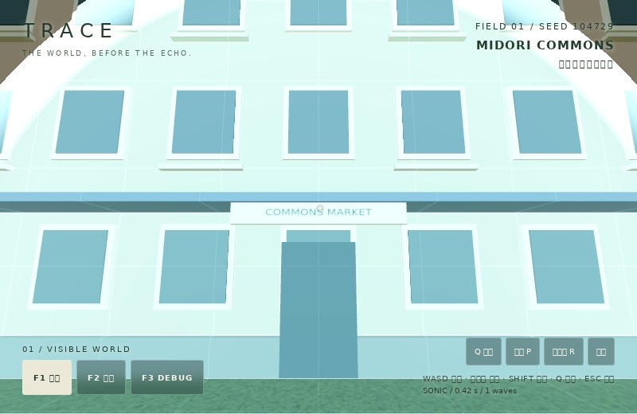
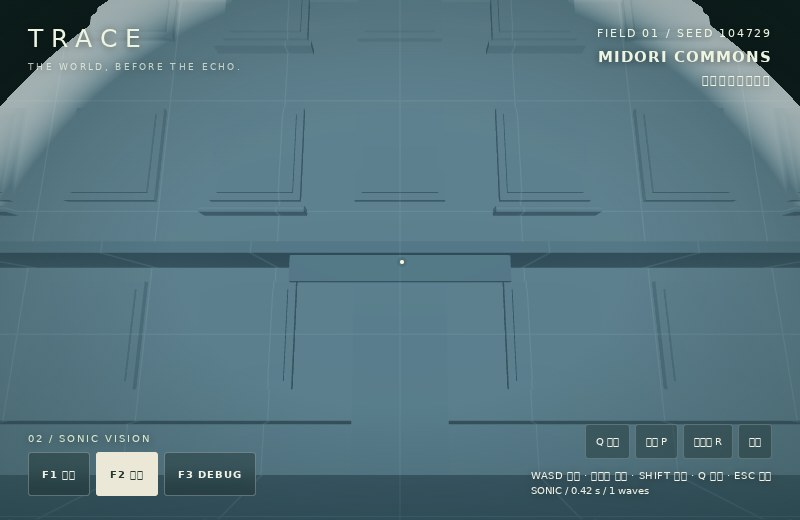
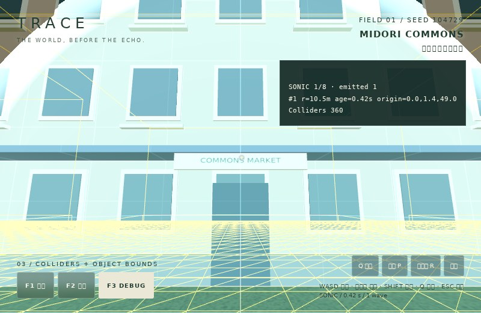
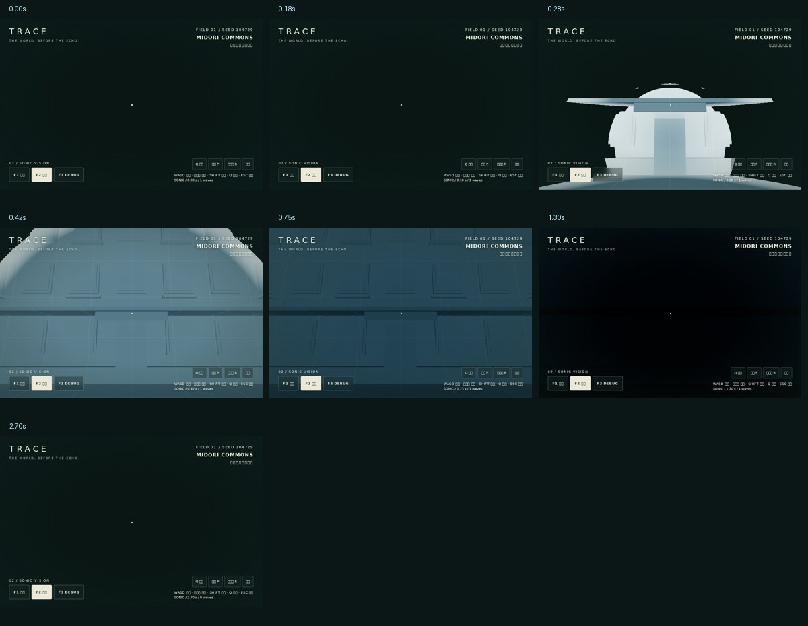
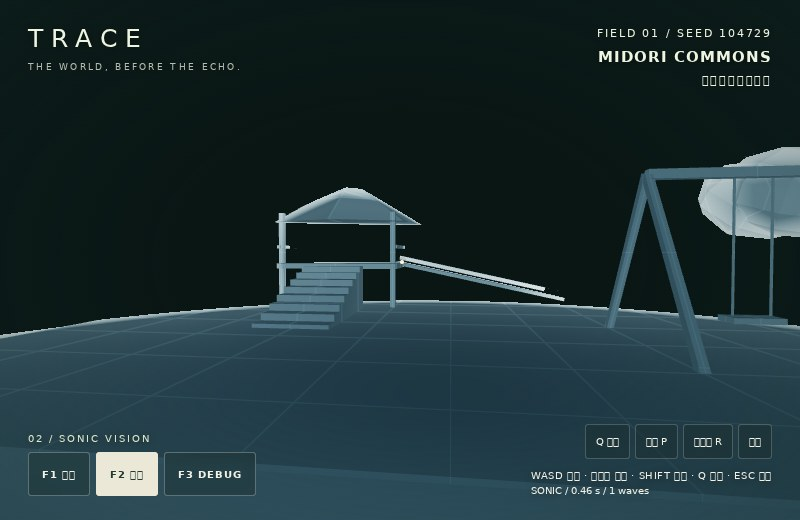
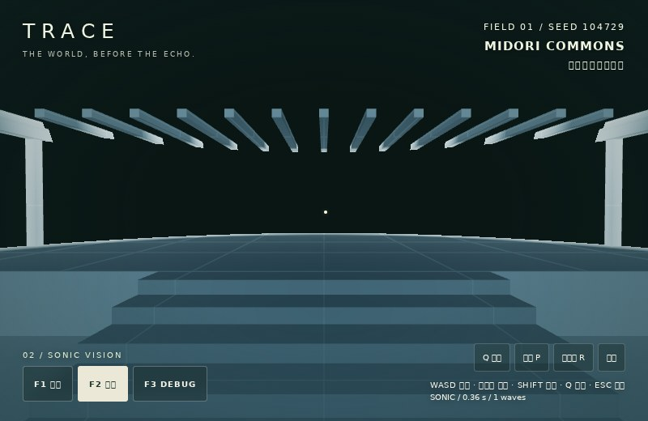
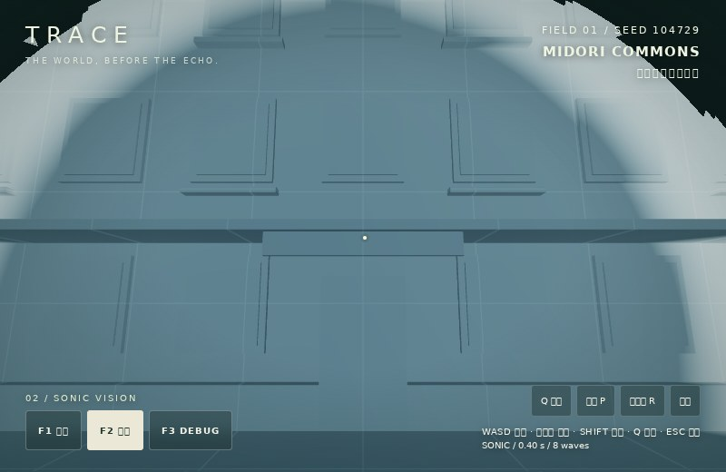

# TRACE Phase 2A / 2B — SONIC VISION

Qキー／音波ボタンで、透明な背景の表面が到達順に現れ、短い残光を残して消える実装。
音波そのものの球体を描いているのではなく、Phase 1の建物・樹木・地面・階段・遊具などの
実Geometryを共有し、表面の各フラグメントを描き分けています。

## 開始時の調査と影響範囲

2026-10-21、ローカルmainと取得したorigin/mainは指定の
`cc16d5957c9752a10dac59d32d7a2a3d4e25b4e9`に一致。未コミット変更なし。
Three.js `0.186.1`、TypeScript `5.9.3`、Vite `7.3.1`、Rapier compat `0.19.3`。

既存の`world/`、`render/world.ts`、`physics/world.ts`、`player/input.ts`、
Phase 1の画像・報告書・テストは変更・削除していません。追加のnpm依存はありません。
第三者コード・素材の追加もなく、既存の配布ライセンス表示を維持しています。

| ファイル | 責務 |
|---|---|
| `src/sonic/config.ts` | 初期設定・最大スロット数・設定の検証 |
| `src/sonic/waves.ts` | 波の発生・固定音源位置・時間・半径・寿命・8スロットの再利用 |
| `src/sonic/vision.ts` | 元のGeometryを共有する96個の可視化メッシュと、共有の専用ShaderMaterial 1個 |
| `src/sonic/debug.ts` | F3のみの波半径リングと、位置・半径・経過時間の表示 |
| `src/diagnostics/gpu.ts` | オプションの非同期GPUタイマー（最大4クエリ、10フレームごとのサンプリング） |
| `src/diagnostics/sonic-probe.ts` | `?test=1`時のみ読み込むGPU画素検証用シーン |
| `src/main.ts` | Q／ボタン入力、時計の更新、F1〜F3との統合、計測表示 |
| `tests/sonic.test.ts` | 波・到達順・残光・スロット上限・元マテリアル保全の単体検証 |
| `tests/sonic-browser.mjs` | シェーダー実描画、画素読み戻し、Q入力、位置一致、比較・連続画像、負荷記録 |
| `.github/workflows/ci.yml` | 従来のテスト・ビルドに加え、ChromiumでGPU画素検証を実行 |
| `README.md`, `package.json` | 操作説明・テストコマンドの追加 |
| `docs/sonic/*`, この文書 | 生の結果JSON・比較画像・連続スクリーンショット |

## 設定と描画モデル

| 項目 | 値 |
|---|---|
| 伝播速度 | 25m/s（視覚表現用） |
| 最大半径 | 35m |
| 波面の厚さ | 1.5m |
| 通過後の残光 | 約1.2秒 |
| 同時波数 | 最大8（超過時は最も古い波を置換） |
| 音源 | 発生時のプレイヤーカプセル中心＋高さ0.65m。発生後はプレイヤーに追従しない |
| 状態の保持時間 | 最大距離への到達1.4秒＋波面幅0.06秒＋残光1.2秒＝2.66秒 |

表面位置をp、音源をs、波の経過時間をaとすると、到達後の時間は
`a - distance(p,s)/speed`。負ならdiscard、最初の0.06秒が明るい波面、その後が二次減衰する残光です。
最大半径の外側と残光終了後は描画しません。複数波は最大強度を選び、重なっただけで過剰に白飛びしないようにしています。

判定は頂点やオブジェクト単位ではなく**フラグメント単位**です。
大きな壁の面が三角形2枚でも、その中を波面が移動します。
インスタンス行列を適用してワールド座標を計算し、画面微分から法線を求めるため、
非一様スケールの建物・枝・階段や地形にも同じ専用シェーダーを使用できます。

F1/F3では元の深度に対して加算の重ね描き、F2では現れた部分だけが深度を書き込みます。
元のMaterial・Geometryを差し替えたり変更したりしません。
F2でもRapierのWorldはそのままです。波がないF2では可視化グループ自体を非表示にします。
球のワイヤーに見えるリングはF3の開発補助だけで、F1/F2の描画には使用しません。

状態管理はThree.jsから独立。描画側は8組の既存uniform領域を更新し、波ごとにGeometryやMaterialを増やしません。
Geometryの所有権は元の背景に残し、可視化側は自分のMaterial・インスタンスバッファのみをdisposeします。
将来の遮蔽・反射は、シェーダーの直接経路計算や追加の反射音源へ拡張できます。現段階は直線距離のみです。

## 実施した検証

- `npm run build`：成功。既存と同じThree.jsバージョンでstrict TypeScriptとVite配布ビルドを確認。
- `npm test`：7件成功（Phase 1の3件＋SONIC VISIONの4件）。
- `npm run test:browser`：既存ブラウザ回帰テスト成功。移動、blur時の入力解除、R復帰、表示切替、狭い画面の配置を維持。
- `npm run test:sonic`：配布ビルドで成功。Q、96メッシュの元Geometryと変換の一致、建物・幹・樹冠・地面・階段・滑り台の収録を確認。
- 実際のシェーダーをWebGLでコンパイル・描画して128×96画素を読み戻し、壁と地面の部分表示・到達順・消失を自動判定。
- 200回の追加発生後も8波以下、Material 1個、Geometry数の増加なし。
- F1→F2→F3を実行し、実Rapier移動による停止位置・コライダー数が一致。
- 比較3枚、波の連続7枚、遊具・階段・8波の画像を撮影して目視確認。
- `git diff --check`：成功。

### GPU画素検証（通常背景を描かない独立した検証シーン）

壁は実際の背景建物と同じBoxGeometryを使い、20m幅×10m高へ配置した制御用シーンです。
地面は実際の地形Geometryそのものを使用。元のメッシュの形を描く同じShaderMaterialを使用しています。
「明るい画素」はRGB合計が10を超える画素、全体は12,288画素です。

| 波の経過時間 | 壁の明るい画素 | 壁中央のRGB合計 | 壁の遠い角のRGB合計 | 地面の明るい画素 |
|---|---:|---:|---:|---:|
| 0.03秒 | 0 | 0 | 0 | 0 |
| 0.12秒 | 688 | 167 | 0 | 780 |
| 0.45秒 | 7,208 | 75 | 145 | 10,604 |
| 1.00秒 | 6,408 | 8 | 33 | — |
| 2.70秒 | 0 | 0 | 0 | 0 |

0.12秒は同じ壁の中央だけが表示され、遠い角は非表示。0.45秒で角にも届き、中央は残光へ移り、最後は消えています。
地面も一度に全体が出現せず、部分から広がっています。

### 衝突判定の一致

| 表示モード | 停止位置 x / y / z（m） | コライダー |
|---|---|---:|
| F1 | 0.021030 / 0.810001 / 3.615039 | 360 |
| F2 | 0.021030 / 0.810001 / 3.615039 | 360 |
| F3 | 0.021030 / 0.810001 / 3.615039 | 360 |

## 表示比較（同じ視点・音源・0.42秒）

F1：元の背景＋音波の重ね描き。

F2：元の表面のうち音波が届いた部分だけ。

F3：元の背景、実コライダー・境界、波半径の開発表示。

## 波の連続フレーム

[0.00秒](sonic/wave-0-0.00s.jpg) · [0.18秒](sonic/wave-1-0.18s.jpg) ·
[0.28秒](sonic/wave-2-0.28s.jpg) · [0.42秒](sonic/wave-3-0.42s.jpg) ·
[0.75秒](sonic/wave-4-0.75s.jpg) · [1.30秒](sonic/wave-5-1.30s.jpg) ·
[2.70秒](sonic/wave-6-2.70s.jpg)

撮影中はQAフックで時計を指定時刻に固定しています。シェーダーと既存マップは実行時と同じです。
0.28秒の壁面は円弧状に切り取られますが、その中に元のドア・窓枠・庇が見えます。

## 描画負荷・FPS

Chromium 153、800×520、headless SwiftShader（ソフトウェア描画）、seed 104729。
同じ壁前の視点で記録した値です。三角形数はデバッグ線分を含みません。

| 状態 | draw calls | 三角形 |
|---|---:|---:|
| F1＋1波 | 140 | 180,890 |
| F2＋1波 | 39 | 71,906 |
| F2＋8波 | 39 | 71,906 |
| F2・全波消失後 | 0 | 0 |
| F3＋1波 | 150 | 180,890 |

撮影実行のF2連続波サンプル：5 FPS、CPU更新・描画送信の平均2.08ms、最大3.00ms、
非同期タイマークエリの取得値116.46ms。
追加検証の同じ短時間サンプルでは2 FPS、CPU平均3.40ms、GPUクエリ結果は取得待ちでした。
**ソフトウェア描画・短時間サンプルであり、実機のGPU性能や維持FPSを示す値ではありません。**

GPU時間は`EXT_disjoint_timer_query_webgl2`を提供する環境だけで非同期取得し、
未提供・結果待ち・disjoint時には`unavailable`を表示します。CPU時間をGPU時間の代わりには使用しません。
通常実行のP計測パネルでもFPS、CPU時間、draw calls、三角形、Geometry・Texture数を表示します。

撮影実行の[生データ](sonic/results.json)、地面検証を含む最終の[生データ](sonic/verification-results.json)、
既存の[Phase 1ブラウザ回帰結果](sonic/phase1-regression.json)。

## 制限・未実装

- 伝播は直線距離。壁を透過し、遮蔽・反射・回折・材質別の伝播や吸音はまだありません。
- メニュー・タブ非表示・フォーカス解除時は操作と波の時計を一時停止。R復帰で既存波を消去。
- 1.5mの波面は25m/sで約0.06秒。低FPSでは明るい先端を飛び越える場合がありますが、残光は残ります。
- 非常に遠い未表示壁は、現れる前に他の表面を隠す深度専用遮蔽物にはしていません。
- 本物の音・足音・射撃・ダメージ・動物AI・通信・SOLOストーリー・VERSUSは未実装。
- WebGL2標準のuniform配列・インスタンス描画・画面微分を使用。浮動小数点描画先やWebGPU等は不要。
  Safari/iPhone/iPad/Windowsの実機動作・持続FPS・発熱は未検証。
- テストホストには日本語フォントがないため、画像内の日本語に欠字があります。アプリは端末のシステムフォントを使用。
- 既存のRapier初期化警告と、Three.js／RapierのViteチャンクサイズ警告は残っています。ビルド失敗ではありません。

CIではテスト7件・配布ビルド後、Chromiumをインストールして同じWebGL画素検証を実行し、
結果JSONを`trace-sonic-webgl-results`として保存します。
