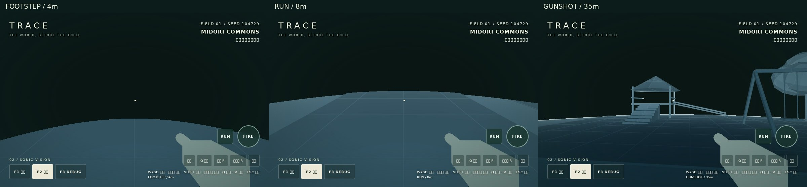
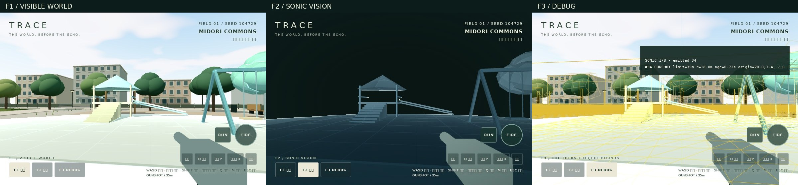

# Phase 2C — SOUND ACTION

基準: main `094384f`。Phase 1 / 2A / 2B の背景、seed、物理、部分表面シェーダーを維持。

## 操作と設定

歩くと足元4m、Shift / RUNで走ると8m、段差から実際に着地すると10mの可視化を発生。
左クリック / FIREで35mの銃声パルスと銃口フラッシュ。射撃間隔0.3秒。
Q / 音波ボタンのTESTは35mのまま。F1通常 / F2透明 / F3コライダー・音波情報。
音量ボタンで0〜100%、M / 消音ボタンでミュート。初期音量40%。

- `src/sonic/kinds.ts`: FOOTSTEP / RUN / LANDING / GUNSHOT / TEST / ANIMALと半径。
- `src/sonic/config.ts`: 速度25m/s、厚さ1.5m、残光1.2秒、全種別合計8波。
- `src/sound/actions.ts`: 実移動距離、歩幅1.65m / 走行1.45m、初動0.25m、射撃クールダウン。
- `src/sound/audio.ts`, `synthesis.ts`: Web Audio、音量、音声数制限、ノイズ・発振器による効果音。
- `src/sound/weapon.ts`: 銃口座標から同じ射撃イベントでパルスと75msフラッシュを開始。

歩行は入力ではなくRapierで衝突解決した前後座標と接地状態から判定。
停止・壁への押しつけ・空中・初期スポーンでは足音を発生しない。
0.2m/s未満の微小な接触揺れを除外。壁沿いに実際に移動すると足音は発生する。
足音位置はカプセル支持面+約7cm。高い床や階段でもその足元を使う。
既存にジャンプ操作はないため追加せず、0.45m以上の落下・0.12秒以上の滞空後の着地に対応。

## システム境界

`SoundActionSystem.emit(kind, origin)` が将来のAI・検証済み通信イベントにも使える共通入口。
`shoot(origin)` が射撃間隔を管理。Yuka / Colyseusの導入や外部通信は行わない。
音波状態はSonicWaveSystem、描画はSonicVisionRenderer、音声はSoundAudioに分離。
可視化は元メッシュのGeometry / transformを共有し、元Materialを変更しない。
シェーダーは各波の種別ごとの最大半径を参照し、表面の各フラグメントへの到達時間で発光・減衰。
描画モードで物理ワールドは切り替えない。

**8波の上限時は種別・残存寿命にかかわらず発生serialが最古の1波を置換。**
短距離音の寿命は各半径 / 速度 + 厚さ / 速度 + 残光。期限切れスロットを優先利用。
重なった表面の強度は加算せず最大値を使用して0〜1に制限し、白飛びを抑える。
全波は既存8スロット・uniform配列を再利用。音声は最大16 voice、最古を停止。
終了したAudioNodeは切断し、視覚用リソースにはdisposeを用意。

## 音声と出典

音声は開始ボタンなどのユーザー操作の中でAudioContextを生成 / resume。
webkitAudioContextをフォールバックし、iOSのユーザー操作制約に対応する構成。
AudioContextが拒否・停止・未対応でも先に音波を確定するため描画は継続。
TEST / ANIMALは現在無音。FOOTSTEP / RUN / LANDING / GUNSHOTのみ生成効果音。
外部音源・新規ランタイム依存はゼロ。全効果音は本リポジトリのノイズ / 発振器合成コードによる。
第三者の音源ライセンスやダウンロード素材に依存しない。

## 検証

```sh
npm test
npm run build
# previewまたはdevサーバーを32803で起動した状態
npm run test:browser
npm run test:sonic
npm run test:sound
```

`test:sound` は実際の入力イベント、Rapier移動、WebGL画素、Web Audioグラフを検証。
`TRACE_CAPTURE=0` で画像を省略、`TRACE_SOUND_OUTPUT` で結果保存先を変更。
CIは単体テスト・ビルド・SONIC VISION / SOUND ACTIONブラウザテストを実行。
保存した計測・比較画像は [sound](sound/) を参照。詳細結果は作業完了時に追記。

## 制限

反射・回折・遮蔽、弾丸・命中・ダメージ、敵・動物AI、対戦・ストーリーは未実装。
音波は障害物を透過する既存の距離ベース表現。ANIMALは拡張用種別のみ。
モバイルSafariを意識した標準Web Audio / WebGL2構成だが、iPhone / iPad / Windowsの実GPU端末、
Safariの音声ポリシー、スピーカーから聞こえる音は未検証。Chromiumタッチエミュレーションや
ヘッドレス音声グラフの成功を、実機での成功とは扱わない。

### 実行結果 — 2026-10-21

- `npm test`: 12 / 12成功（既存7件＋種別・音声失敗・射撃間隔・足音／着地・実Rapier移動5件）。
- `npm run build`: 成功。既存Three / Rapierの大きなchunkに対するVite警告は残る。
- `npm run test:browser`: 成功、例外0。[Phase 1回帰結果](sound/phase1-regression.json)。
- `npm run test:sonic`: 成功、96個の元Geometry / transform共有、壁の部分到達・残光消失・seed・全モード衝突一致。[結果](sound/sonic-regression.json)。
- `npm run test:sound`: 成功、例外0。[全結果](sound/results.json)。

| 確認項目 | 結果 |
|---|---|
| 実移動1.5秒 | 歩行4回、走行7回、足元y約0.08m |
| 停止2秒 / 壁押し3秒 | 追加音波0 / 0 |
| 1m段差から実際に落下 | LANDING 1回 |
| 同時刻の2クリック | 射撃1回、35m波1個、フラッシュ同期 |
| Q＋足音＋走行＋銃声 | 4種別共存 |
| 160回の混在発生 | 最新8波のみ、音声16voice以内 |
| 音量15%・ミュート | 音量反映、ミュート中も射撃波は発生 |
| AudioContext生成を強制拒否 | unavailable表示、GUNSHOT可視化継続 |
| Chromium 390×844タッチ | 視点タップでは射撃しない、FIREで射撃、RUN切替 |
| F1 / F2 / F3の衝突停止座標 | すべて x=0.02103, y=0.81000, z=3.61504、360コライダー |

地面12,288画素の同一WebGL検査（発生0.4秒後）で、歩行は1,832画素、走行6,976画素、
銃声9,328画素を可視化。6m地点は歩行0、走行133、銃声133で、実シェーダーの半径差を確認。
生成音のOfflineAudioContext検査は全4種類で非ゼロRMS、peak<1、末尾エネルギー0。
ライブAudioContextのrunningと音声発生数も確認したが、実際に聞いての音質評価は未実施。

### 性能計測の区別

| 環境 | シナリオ | 記録 |
|---|---|---|
| Chromium 153 / ANGLE SwiftShader（ソフトウェア）800×520 | F2、0.33秒ごと射撃、3.5秒サンプル | 1 FPS、JS側処理2.7ms / 最大2.9ms、75 draw calls、120,394 triangles |
| 同ソフトウェア上の任意GPU timer拡張 | 上記シーン | 552.45ms（実GPU値ではない） |
| 実GPU Windows / iPhone / iPad | 未実施 | FPS・GPU時間・温度・消費電力・Safari再生は不明 |

短時間・共有CPU環境の参考値であり、GPU端末のプレイ性能や合格判定には使用しない。
実機でP表示と同一seed・同一座標・同一解像度・同一発生周期を記録する必要がある。
GPUタイマー非対応ならunavailable、VRAMはunknownと表示。架空の性能値で補完しない。

### 比較画像

以下はPlaywright + SwiftShaderで実際に描画した画面。画像の日本語部分が四角に見えるのは
このキャプチャ環境に日本語フォントがないため。アプリに外部フォントは追加していない。
足音／走行は実際の移動から最初に出た波を0.4秒進めて同じカメラで比較。
銃声は遊具・階段・樹木が見える位置で0.72秒後。モード比較は同じ波・同じ視点。





[銃口フラッシュ](sound/muzzle-flash.jpg) / [モバイル操作](sound/mobile-controls.jpg)

優先度の高い未解決のブラウザ例外は検出されなかった。
修正済み: ポインターロック中クリックのcapture例外、接触揺れによる余分な足音、
タッチ視点の左右境界越えで移動扱いになる問題、縦画面の銃口位置・モードボタン改行。
