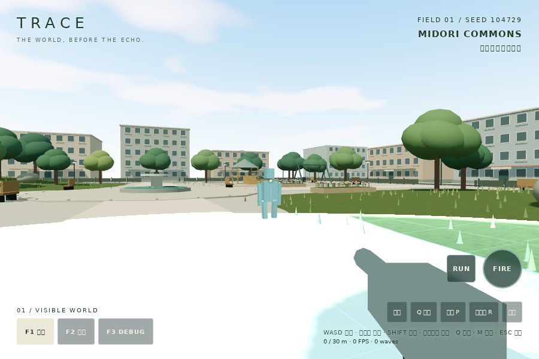
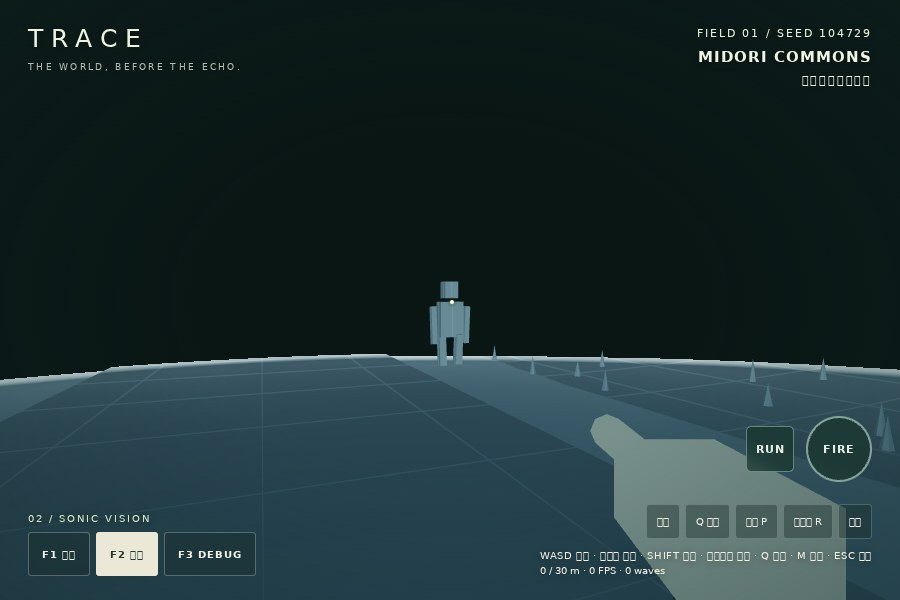
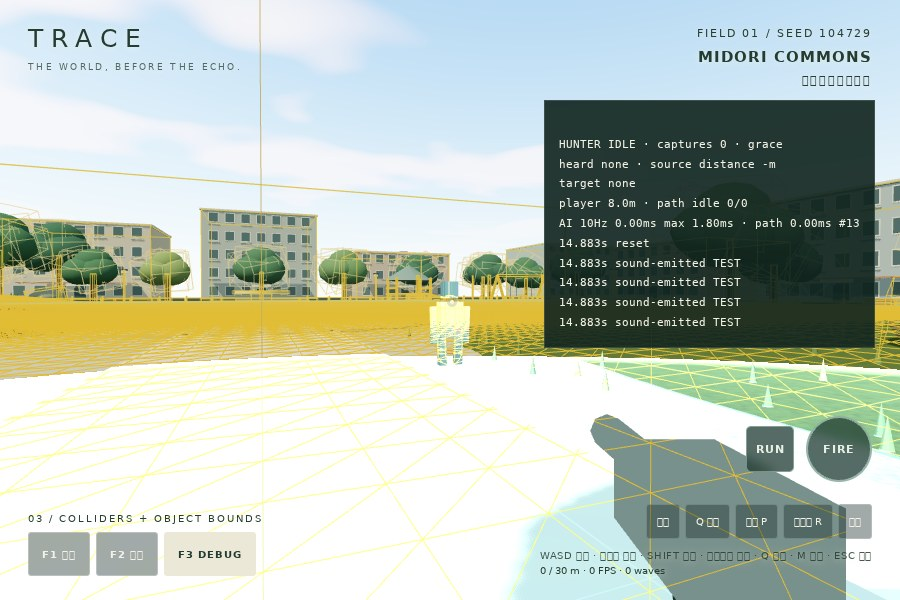

# Phase 3A — ECHO HUNTER

基準main: `ca3cbb6`。敵1体。「見えるための音が、敵にも届く」を検証する段階。
公開先: https://yuji5124.github.io/TRACE/

## 遊び方

開始 → F2 → Qで探索。敵も35m以内のQを聞き、音を出した地点へ来る。
足音は歩行4m / 走行8m、着地10m、銃声35m。クリック / FIREは敵を倒さず、大きな音を出す。
走る方が速いが、近くの敵へ音源位置が伝わりやすい。壁・建物などで視線を切り、移動して離れる。
敵が近い時は生成効果音と位置・方向を示さない短い注意文。消音時も注意文が残る。
捕捉されたら短い画面演出後、同じ公園入口から再開。5秒間は再捕捉されない。

F1は通常モデル、F2は通常モデルを非表示にし、音波が通る表面だけを表示。
F3に状態・最後の音・音源距離・目標・プレイヤー距離・経路状態・AI処理時間・捕捉数・直近ログ。
F2でPを押しても敵のデバッグ情報は出さない。敵の座標やマーカーは通常HUDに表示しない。

## 状態と知覚

| 状態 | 行動と遷移 |
|---|---|
| IDLE | 短い待機とseed由来の周辺巡回。音を聞くとINVESTIGATE、6m以内で実コライダー越しに視認できればCHASE |
| INVESTIGATE | 聞いた音源の固定座標へ移動。認識時CHASE、到達 / 9秒の記憶期限でSEARCH |
| SEARCH | 最後に見た / 聞いた地点を基準に5秒探索。新しい音でINVESTIGATE、再視認でCHASE、期限でRETURN |
| CHASE | 13m以内・Rapier視線が通った時だけ現在位置を更新。見失って0.8秒で最後の視認位置をSEARCH |
| RETURN | ホームへ戻る。到着または時間上限でIDLE。音や近距離視認には再反応 |

視認は全方位の距離＋実Rapier raycastで判定する簡易仕様。視界方向のコーンは未実装。
AIへ渡すプレイヤー座標は知覚・捕捉判定用。経路目標を現在のプレイヤー位置で更新するのは
視認成立時だけ。音から得られるのは音が発生した過去の座標。視認を失うと現在座標を追わない。

聴覚は可視化と別設定 `src/hunter/config.ts`。初期範囲はPhase 2Cと一致。
音の伝播は既存25m/sの波時刻と同じ到達距離で評価し、AIの10Hz更新で検出。
近距離音ほど反応待ちが短く調査速度も高い。銃声 > Q > 着地 > 走行 > 歩行の優先順位。
強い音は2秒間、弱い音による上書きを抑える。その後は新しい音で目標更新できる。
音の遮蔽・反射・回折は未実装。視線の遮蔽とは分離している。

## 実装構成

- `src/sonic/waves.ts`: 不変の発生イベントを購読可能に。8描画スロットの再利用で音源記憶が書き換わらない。
- `src/hunter/config.ts`: 聴覚半径・優先度・更新周期・移動速度・視認・記憶・捕捉設定。
- `src/hunter/hunter.ts`: 状態・音の記憶・知覚・ログ・経路更新。Three.jsから独立。
- `src/hunter/navigation.ts`: 実コライダー由来の高さ・空間余裕を持つ1m格子とA*。
- `src/hunter/motor.ts`: 専用Rapierカプセル / character controller。既存プレイヤーと同じworld.stepで更新。
- `src/hunter/view.ts`: 6個の箱による簡易モデル。単一Geometry / 通常Materialを共有。
- `src/sonic/vision.ts`: 動く元メッシュのworld matrixを参照するオプション。敵の表面を元形状で可視化。
- `src/sound/audio.ts`: 既存Web Audioに距離減衰付きの敵の足音 / 反応音を追加。AIから音声成功に依存しない。
- `src/main.ts`: 一括ラウンドリセット・捕捉演出・最小危険通知・F3統合。

## 経路と物理

高さ・クリアランス格子を起動時だけ作成。上下に動くNavMeshや外部AIライブラリは導入しない。
四近傍で角抜けを抑え、各辺の25cm間隔の支持面を事前検査して、階段と登れない側面を区別。
カプセル余裕には26cmのautostepを考慮。高い屋根・ベンチ・花壇を床として扱わない。
足場は地面・既存の階段・テラス・遊具デッキ。1m解像度のため狭い隙間は保守的に閉じる。

経路は毎秒1回以下、探索上限14,000セル。実物理で進めなければ次のセルを一時回避して再探索。
3回連続で経路に失敗すると探索 / 待機へ戻り、無理な直進・テレポートをしない。
回避セル数32、未到達音64、ログ128に上限。視覚音波は既存どおり全種別で8個。
敵の音はプレイヤー用可視化イベントへ再投入しないので、自分の足音を聞く無限ループはない。

## リセットと保全

捕捉判定は1.05m以内、視線が通ること、無敵期限が過ぎていることが条件。
捕捉・R・入口ボタンで、プレイヤー / 敵の位置、音波、聴覚待ち列、音源記憶、経路、入力、
武器フラッシュ、音声voiceを整理。捕捉回数とログは検証用に保持。
背景seed・オブジェクト配置・元Material・音波パラメータは変更しない。
静的360コライダーに敵の1カプセルを追加し、全表示モードで361個を共有。

既存12件の単体テストは変更なし。ブラウザ検証の各独立ケースでは `resetRound()` を使い、
プレイヤーだけでなく敵・聴覚も同じ初期状態に戻す。既存assertは削除していない。
Pagesワークフローは変更せず、既存CIにECHO HUNTERの検査と結果artifactを追加。

## 検証の再実行

```sh
npm test
npm run build
# dev / previewをport 32803で起動して
npm run test:browser
npm run test:sonic
npm run test:sound
npm run test:hunter
# 公開後
npm run test:pages
TRACE_URL=https://yuji5124.github.io/TRACE npm run test:hunter
```

`?test=1` の `window.traceTest.hunter.logs` に発生・heard・状態遷移・失敗・捕捉・resetのログ。
`TRACE_CAPTURE=0` は画像省略。`TRACE_HUNTER_OUTPUT` は結果保存先。
WebGL検査は敵の実プロキシを別RenderTargetへ描き、到達前・部分表示・広い表示・消失を画素検証する。
敵が移動 / アニメーションしても元Geometry・transformが一致することを確認する。

## 実機・未実装事項

Windows Chrome実機、iPhone / iPad Safari実機はこの環境から未検証。
Linux Chromium / SwiftShaderでの自動操作、固定ステップのCPU処理時間と、実GPUのFPSを区別する。
スピーカーで聞いた音質、実マウスでの操作感、端末発熱・電力・VRAMは未検証。

Phase 3B: 実機で見失わせる難易度・8mの走行音再検知・13mの全方位視認を調整し、
視野角、壁際の探索、狭い通路の足場、移動時の敵シルエット、危険通知の閾値を検証する。
今回、HP・ダメージ・敵の複数化・Yuka・Colyseus・対戦・ストーリー・本格音響物理は導入しない。

外部モデル・音源・新規依存は使用せず、敵形状・生成効果音・AI・経路探索はこのリポジトリで作成。
既存の[ライセンス表示](../public/THIRD_PARTY_NOTICES.txt)を維持。


## 実行結果 — 2026-10-22（日本時間）

- npm test: **24 / 24成功**（既存12件はそのまま、追加12件）。
- npm run build: 成功。既存Three / Rapierのchunkサイズ警告は残る。
- test:browser / test:sonic / test:sound / test:hunter: 成功、JavaScript例外0。
- 敵の実メッシュ画素数: 0.29秒=0、0.32秒=483、0.42秒=1,029、2.7秒=0。
- 全モードで361コライダー、敵のGeometry / world transform一致。
- 消音中でも近接注意文が表示され、F2の敵デバッグ欄は非表示。
- 捕捉1回 → IDLE・入口z=30・無敵ON・聴覚待ち列0・可視波0へリセット。

[敵AIの全ログ・計測](hunter/results.json) / [世界回帰](hunter/world-regression.json) /
[SONIC回帰](hunter/sonic-regression.json) / [SOUND回帰](hunter/sound-regression.json)

### 実際の自動プレイで観察したこと

1. 入口のQを約25.07m先で聞き、約1.1秒の伝播後にINVESTIGATEへ。
   接近するとCHASE、走って離れるとSEARCH。移動先ではなく最後の視認位置を目標として保持した。
2. 噴水を挟むと実コライダーで視線が切れ、0.8秒後にSEARCHへ移る。
   この遮蔽ケースでは、再現性のため敵の短い待機をテストから指定して視線だけを分離検証した。
3. 樹木が入口付近の逃走ライン上にあり、真っ直ぐ走ると横へ押し出された。
   Shift中でも実速度が低下した時にFOOTSTEPへ切り替わった。入力だけでRUNを出し続けない結果。
4. 当初、1m格子の高さ差だけでは階段の側面を登れると誤判定した。
   25cm間隔の支持面検査とautostep余裕を追加し、実Rapierで建物迂回・階段登りが成功した。
5. 連続音で目標更新のたびに経路を消す / 反応停止を繰り返す問題を検査で防止。
   同じINVESTIGATE中は既存経路を次の再計算まで保持し、初回の反応待機と首振り演出を分離した。

自動プレイは実際のブラウザ入力＋同じ固定ステップシミュレーションで実行。
Windowsの人間による試遊・主観的な恐怖や操作感の評価は未実施。

### 性能の区別

| 検査 | 結果 | 意味 |
|---|---|---|
| 固定10秒・600物理ステップ | 64.7ms、AI 100回、経路6回 | このLinux CPU上の非描画シミュレーション、実GPU FPSではない |
| AI判断最大 | 1.80ms | 経路処理を含むこの検査での最大値 |
| 起動時格子構築 | 369.2ms | 1回だけ、毎フレームではない |
| SwiftShader・900×600・F2・Qを0.8秒周期で発生・3.5秒 | 3 FPS、96 draw calls、122,032 triangles | ソフトウェア描画の短時間参考値 |
| 同環境のGPU timer | 271.45ms | ソフトウェア上の時間。物理GPUの性能値ではない |
| Windows Chrome / iPhone / iPad Safari実機 | 未検証 | 実機の合格扱いにはしない |


### 比較画像







[Qを聞いて調査中](hunter/01-investigate.jpg) / [逃走中](hunter/02-escape.jpg) /
[捕捉と再開](hunter/03-capture.jpg)

画像はカメラ・時刻を固定して検証した実WebGL画面。F1/F3の例はQの重ね描き中。
キャプチャ環境に日本語フォントがなく、一部文字は四角になる。実機の字体確認も未実施。

## 公開環境の確認

実装コミット `858bf9a23e8ba43dc5a8b9f5ecaf1b0f40ae519c` の
[Pagesデプロイ](https://github.com/Yuji5124/TRACE/actions/runs/39630991686)が成功。
公開URLでHTTP 200、JS / CSS / 分割チャンク / 内包WASM初期化、移動・射撃・全モードを再確認。
さらに同じ公開URLで敵の調査・追跡・視線喪失・部分表面表示・消音通知・捕捉後再開の
ブラウザ検証が成功、例外0件。

[公開ページの全リクエストと操作結果](hunter/public-pages.json) /
[公開上の敵AIループ・ログ・計測](hunter/public-hunter.json)。
公開検証もLinux Chromium / SwiftShaderであり、Windows / Safari実機ではない。
公開上の参考値は2 FPS、96 draw calls。ローカルの3 FPSとの差は実GPU性能差を意味しない。
通信プロキシ用証明書のChromium回避設定を検証ホストに限定して使用（詳細は[PAGES.md](PAGES.md)）。
既存のライブラリ非推奨警告は残るが、新規の致命的エラー・アセット404は検出されなかった。

[実装コミットのCI](https://github.com/Yuji5124/TRACE/actions/runs/39630991784)も成功。
24件の単体テスト、ビルド、SONIC / SOUND / HUNTERのブラウザ検証を通過。
この確認後の追記コミットは検証JSONとこの報告だけを追加し、ゲームコードは変更しない。
