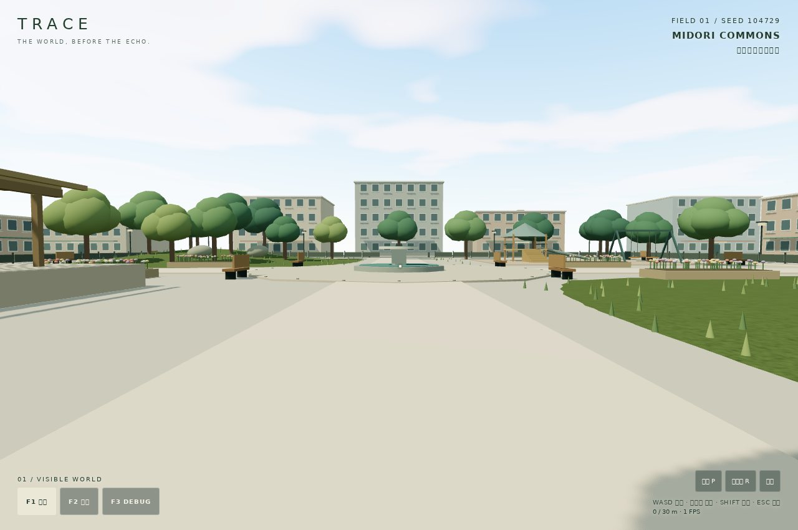
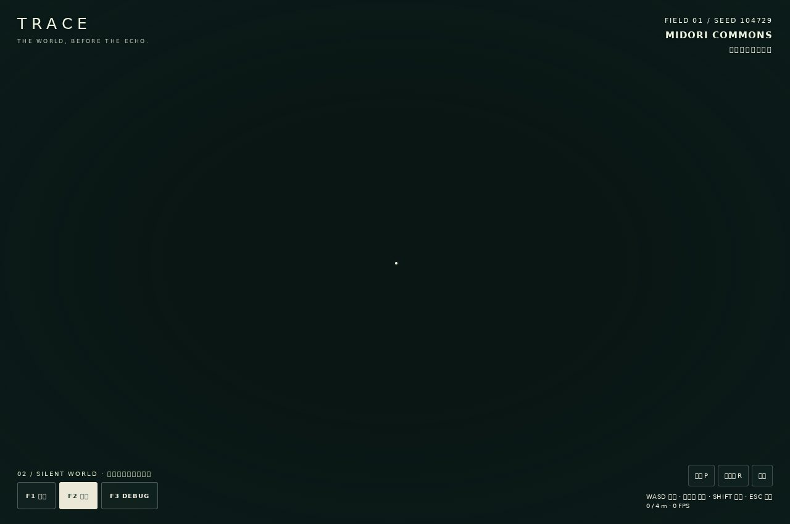
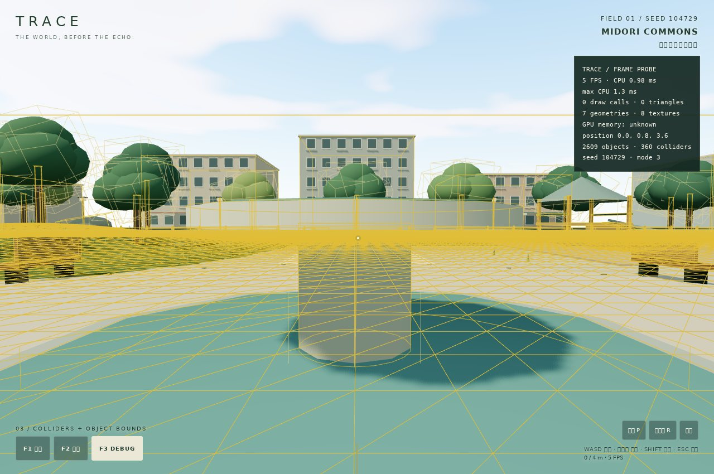
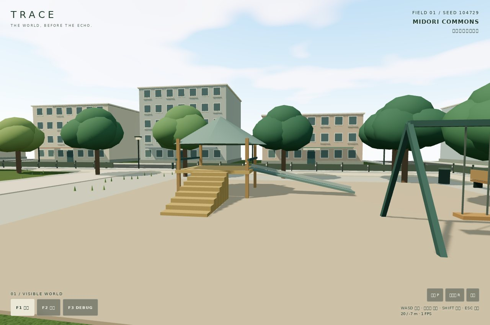
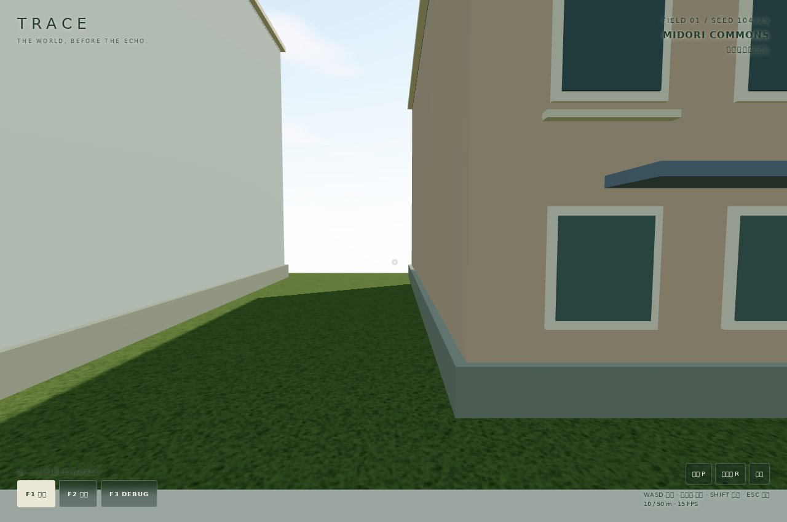
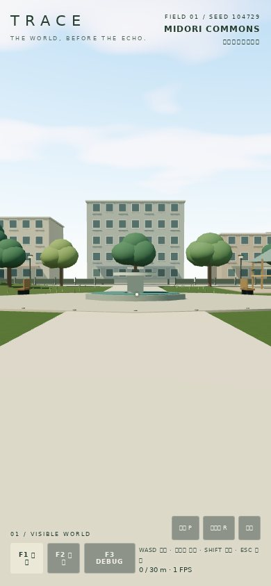

# Phase 1 validation — 2026-10-21

## Checks

- `npm run build`: PASS. Strict TypeScript check + production Vite bundle.
- `npm test`: PASS, 3 tests: seed determinism/variation and valid object data;
  seed parsing/flat circulation and raised planting; real Rapier movement against
  terrain, fountain, stairs/terrace and perimeter without creating visuals.
- Browser: Chromium 153 / headless SwiftShader, desktop 1280 × 850 and
  mobile layout 390 × 844. Test source: `tests/playtest.mjs`.
- F1/F2/F3 keyboard switches exercise actual mode handlers. The same capsule path
  stops at the same position in all modes, and collider counts remain unchanged.
- Invisible BVH ground query remains available in F2.
- Actual W key movement, key release, blur clearing and R reset are exercised.
- Desktop/mobile and mode screenshots are visually reviewed.
- No browser page errors observed.
- `git diff --check`: PASS.

## World inventory (default seed 104729)

2,609 procedural objects, including 32 tree trunks and 16 exterior buildings.
354 object collision proxies; total 360 Rapier colliders including terrain,
4 map bounds and the player capsule. Stable map version 1, 150 × 150 metres.

## Mode parity

| Mode | Visual world | Capsule stop x / y / z (m) | Colliders |
|---|---|---|---|
| F1 | Visible | 0.021030 / 0.810001 / 3.615039 | 360 |
| F2 | Hidden | 0.021030 / 0.810001 / 3.615039 | 360 |
| F3 | Visible + debug | 0.021030 / 0.810001 / 3.615039 | 360 |

The ground query at (-25, -25) returns 1.595m in every mode.
Final production logic/input verification used `TRACE_CAPTURE=0`; screenshots were
collected separately during the browser passes. Raw final browser results: [browser-results.json](browser-results.json).

## Evidence

## Limits

Headless SwiftShader is a software renderer: its FPS is not a device-GPU benchmark.
The panel reports draw calls, triangles, CPU frame work, FPS and resource counts;
GPU memory remains explicitly unknown. Debug terrain wireframes are intentionally
more expensive than normal mode. Final report JSON records the measured snapshot.
The test host lacks Japanese fonts, so screenshot glyphs can be missing; the app
uses native system fonts and ships no external font downloads.

Physical Windows/iPad/iPhone input feel, sustained FPS and thermal behaviour have
not been tested. Browser automation verifies the narrow viewport layout; it does
not establish real-device touch ergonomics or pointer-lock compatibility on every
browser. Building interiors, jumping, audio visualization, combat, networking and
story are outside Phase 1.

The build has Vite's large-chunk advisory (Three.js and embedded Rapier WASM).
Rapier 0.19.3 also prints an upstream WASM-init deprecation warning; initialization
and all collision tests pass. No warning is hidden and no dependency is modified.
